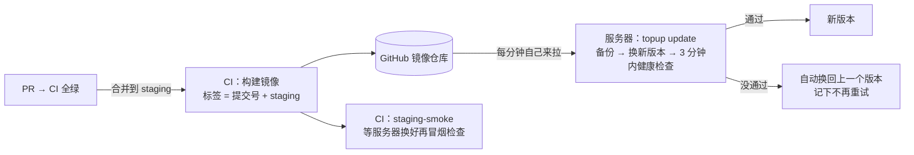

# 部署（测试环境；生产换服务器后沿用）

一台 Ubuntu 24.04 服务器，Docker Compose 跑 5 个容器：Nginx（HTTPS）→ web；worker；Postgres 16；Redis 7。
合并到 `staging` 且 CI 全绿后，CI 构建镜像推到 GitHub 镜像仓库；服务器每分钟自己来拉，起不来自动换回上一个版本。GitHub 不登录服务器，服务器上不放任何 GitHub 的写权限。



## 1. 文件
| 文件 | 作用 |
|---|---|
| `deploy/compose.yml` | 5 个容器、内存上限、只有 Nginx 对外（80、443），web 的 8080 只绑本机 18080 给部署脚本看健康检查 |
| `deploy/nginx/default.conf.template` | HTTPS、http 跳 https、用 IP 访问 443 直接断开、真实 IP（`X-Real-IP`、`X-Forwarded-For` 用 `$remote_addr` 覆盖）、第一道限流 |
| `deploy/kit/topup.sh` | 服务器上的命令 `sudo topup …`（下面第 2 节） |
| `deploy/kit/systemd/` | 三个定时器：`topup-update`（每分钟）、`topup-backup`（每天 UTC 19:40）、`topup-watch`（每 5 分钟） |
| `e2e/deploy-drill.sh` | 演练：在开发机上用真实镜像把各种场景跑一遍 |

镜像里带着 `deploy/`（`/topup-kit`），服务器每次更新版本时从镜像里取出部署工具包，工具包和应用永远是同一个提交。

## 2. 命令
第一次部署之前（只做一次）：第一次合并到 `staging`、CI 的 image 推送成功之后，把镜像包设成公开——GitHub 头像 → Your profile → Packages → `topup` → Package settings → Danger Zone → Change visibility → Public。服务器不登录 GitHub，是匿名拉镜像；包是私有的话第一步就拉不到。镜像里只有公开仓库的代码，没有密钥。（未验证：GitHub 文档说第一次推送的包默认私有，从公开仓库推送时会不会自动公开没有核实；包页面已经显示 Public 就跳过这一步。）

第一次部署是一条命令（管理员在云控制台的"远程连接"终端里粘贴，镜像名和域名换成实际的）：

```bash
curl -fsSL https://raw.githubusercontent.com/<所有者>/TopUP/staging/deploy/kit/topup.sh -o /tmp/topup.sh && sudo TOPUP_IMAGE=ghcr.io/<所有者小写>/topup bash /tmp/topup.sh install <域名> <证书提醒邮箱>
```

它做 8 步，每步一行 ✓ / ✗，失败时写原因和下一步然后停下；可以重复运行（做完的步骤跳过，已有的口令不重新生成）：
装软件（Docker、certbot、age、jq；`rclone` 只在打开异地备份时才要）→ 取部署工具包 → 生成配置文件（内部口令、主密钥随机生成、不显示）→ 停同一台服务器上别的项目（同一时间只运行一个）→ 检查内存和磁盘 → 申请证书 → 启动 → 打开定时器。最后打印一份不含密钥的摘要。

| 命令 | 做什么 |
|---|---|
| `sudo topup status` | 版本、容器、健康检查、还没填的变量、备份、证书、内存、磁盘、检查发现的问题 |
| `sudo topup keys` | 哪些密钥已填（只显示名字）、普通设置的值 |
| `sudo topup set-key 变量名` | 填密钥：屏幕上不显示；只接受清单里的名字；拒绝空格、引号、`$` 等；私钥、节点地址、邮箱先检查格式；写完自动重建 web、worker，报告健康检查里对应的一项 |
| `sudo topup set 变量名 值` | 填普通设置（收件人、确认数等） |
| `sudo topup gen-operator` | 只用于测试环境：在服务器上随机生成两个归集发起账户（ETH/BSC 一把、TRON 一把，已有的不重新生成），私钥只写进 `.env`，屏幕上只显示地址（拿去领测试币、登记进合约） |
| `sudo topup admin-token` | 在终端上显示一次运营后台的初始化口令（不进日志）；初始化完成后后台拒绝再次初始化，口令就没用了 |
| `sudo topup test-mail` | 发一封测试邮件到 `MAIL_TO` |
| `sudo topup backup` | 立刻备份一次（本机加密保存，默认不传到别处） |
| `sudo topup restore-drill` | 恢复演练：本机最近一份备份解密后恢复进临时容器，核对表、行数、Redis、开户文件、主密钥；不碰正在运行的数据，解密出的临时文件用完删除 |
| `sudo topup backup-key`、`restore-drill --from-r2` | 异地备份用（默认关闭，见第 5 节）：生成管理员的备份密钥对（公钥写进 `deploy.env`，私钥只在屏幕上显示一次）；从 R2 下载最新一份、粘贴私钥解密后演练 |
| `sudo topup rollback` | 换回上一个版本，并且不再自动更新到当前版本 |
| `sudo topup retry` | 清掉"不再重试"的记录（`state/skip`），下一分钟重新尝试最新版本 |
| `sudo topup stop` / `start` | 停下（定时器 → 应用 → 备份 → 数据库，数据保留）/ 启动（先按同样的顺序停别的项目） |

在控制台运行 `set-key` 时用"远程连接"的普通终端，不要用控制台自带的 AI 助手，也不要把任何值发给对话框。

## 3. 内存总账（容器不用交换分区：`mem_limit` = `memswap_limit`）
| 容器 | 上限 | 怎么来的 |
|---|---|---|
| postgres | 320 MB | `shared_buffers` 64 MB + 30 个连接 × 约 5 MB + `maintenance_work_mem` 32 MB + 进程本身 |
| redis | 96 MB | `maxmemory 64mb`（写满报错、不淘汰数据）+ 进程和 AOF 重写 |
| web | 288 MB | Node 堆 `--max-old-space-size=160` + 代码、缓冲区约 100 MB |
| worker | 288 MB | 同 web |
| nginx | 48 MB | 实际十几 MB |
| 合计 | 1,040 MB | 启动前要求服务器可用内存 ≥ 1,140 MB（`install`、`start` 会检查，不够就不启动） |

## 4. 两个配置文件（只在服务器上，权限 600，不进仓库、不进镜像）
- `deploy.env`：部署用。`install` 生成：`TOPUP_DIR`、`TOPUP_IMAGE`、`TOPUP_ENV`、`DOMAIN`、`CERT_EMAIL`、`CERT_NAME`、`LE_DIR`、`WEBROOT_DIR`、`POSTGRES_PASSWORD`、`REDIS_PASSWORD`；`BACKUP_OFFSITE=off`（异地备份默认关）。只有打开异地备份时才用到：`backup-key` 写 `BACKUP_AGE_RECIPIENT`；管理员填 `R2_ACCOUNT_ID`、`R2_BUCKET`（`set`）和 `R2_ACCESS_KEY_ID`、`R2_SECRET_ACCESS_KEY`（`set-key`）。本机备份的加密密钥在 `state/backup-identity`（服务器生成，600）。
- `.env`：应用用，变量见仓库根目录 `.env.example`。`install` 生成 `APP_SECRET`、`ADMIN_SETUP_TOKEN`，设 `TRON_NETWORK=nile`；其余由管理员用 `set-key` / `set` 填。`APP_ENV`、`PUBLIC_URL`、`DATABASE_URL`、`REDIS_URL`、`BLOB_DIR`、`TRUST_PROXY=1`、`HOST`、`PORT` 由 `compose.yml` 决定，不放进 `.env`。

## 5. 备份和恢复
- 内容：`pg_dump`（Postgres）、Redis 快照（开户资料和管理员会话在 Redis 里）、开户文件目录、两个配置文件（主密钥 `APP_SECRET` 丢了开户资料就解不开）。
- 什么时候：每天 UTC 19:40；每次自动更新前；`stop` 前。
- **默认只在本机、加密**：`backup/topup-<时间>-<标签>.tar.age`，用 `age` 加密（收件人 = 服务器自己生成的 `state/backup-identity`；管理员跑过 `backup-key` 的话也加上他的公钥），打包时直接写进 `age`，磁盘上不留明文整包。目录 700、文件 600。
- 加密防的是：备份文件被单独拷走（下载、误传）。防不了：有服务器 root 权限的人（他本来就能读 `.env`）；整台服务器丢失（备份跟着丢）。测试环境只有测试数据，这个风险可以接受；上生产前再定异地备份。
- 保留：超过 7 天的删掉；本机备份合计超过 2 GB（`TOPUP_BACKUP_MAX_MB`，默认 2048）时从最旧的删起；无论如何至少留最新 3 份。以前版本留下的明文 `.tar` 会被删掉。
- 异地（Cloudflare R2）：**默认关闭**（`BACKUP_OFFSITE=off`），没配置不报错。以后要开：`sudo topup backup-key`（管理员私钥存进密码管理器）→ `set BACKUP_OFFSITE r2` → 填 `R2_…` → 装 `rclone`；上传的是同一份密文（配置只经环境变量交给 `rclone`）。打开了但没配好：本机照样备份，只提示、记 `r2=not_configured`；上传失败才报错。
- 恢复演练：`sudo topup restore-drill`（本机那份，用本机密钥解密到临时目录，用完删除）；打开异地后可以 `--from-r2`（下载 R2 上最新一份，管理员粘贴私钥解密，私钥只在内存盘里用完即删）。

## 6. 检查和告警
- 自动更新只看"应用活着"：提交号对得上、数据库、Redis、主密钥、web 的收付款初始化成功（健康检查里有 `wallet` 一项）、换版本之后新的 worker 跑过一轮（扫链时间晚于开始等待的时间，旧 worker 留下的不算）。邮件、节点 Key 没填不算失败（换回旧版本也解决不了）。
- web 和 worker 同时启动时都会建表：建表在数据库锁里做（`server/pay/schema.js` 的 `migrate`），不会互相撞。
- `topup-watch` 每 5 分钟：web 没响应、健康检查 `ok=false`（列出哪几项）、worker 停了、磁盘 ≥ 85%、可用内存 < 100 MB、超过 26 小时没备份、上一次备份没加密、上传 R2 失败（只在打开异地时）、有版本更新失败被跳过、证书 14 天内过期。**状态变化时**用应用自己的发信设置发一封邮件给 `MAIL_TO`（问题不变不重复发，恢复时再发一封）。
- 服务器整台宕机时它发不出邮件：要从外部定时探测，另外开（默认不开）。

## 7. 真实 IP
Nginx 用 `$remote_addr` 覆盖 `X-Real-IP` 和 `X-Forwarded-For`；web 设 `TRUST_PROXY=1`，付款页和开放 API 的按 IP 限流用这个值。域名的 DNS 要选"仅解析"（不经过 CDN 代理），否则所有访客的 `$remote_addr` 都是 CDN 的地址。web 的端口只绑 `127.0.0.1`（绕过 Nginx 直连时应用会相信请求头）。`e2e/deploy-drill.sh` 场景 3 实测了这两点。

## 8. 演练
```bash
docker build --build-arg APP_ENV=staging -t topup-drill-base .
sudo bash e2e/deploy-drill.sh topup-drill-base
```
在临时目录里跑 11 个场景（外加发起账户生成、初始化口令）：第一次部署（另一个项目占着 80、443）、重复运行、经 Nginx 访问和真实 IP、填密钥（名字和值写错）、自动更新成功、新版本起不来自动换回、手动回滚和重试、备份和恢复演练、每 5 分钟检查、内存不够和 stop / start、新版本"没活"（web 初始化失败；新 worker 不扫链而旧 worker 的扫链时间还新鲜）也要换回。演练模式不装软件、不碰 systemd、证书自签名，所以这三样要在第一次真实部署时逐步确认。
