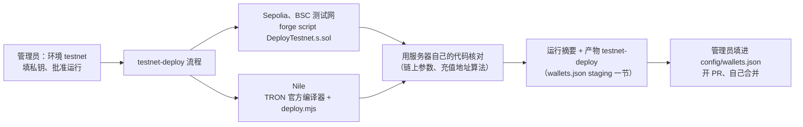

# 测试网合约部署（Sepolia、BSC 测试网、TRON Nile）

测试环境要用的合约由 GitHub Actions 部署：`.github/workflows/testnet-deploy.yml` → `scripts/testnet/deploy.mjs`。部署账户的私钥只放在 GitHub 环境 `testnet` 的环境密钥里，每次运行都要管理员在 GitHub 上批准。部署出的地址（公开信息）写进运行摘要和产物 `testnet-deploy`，由管理员填进 `config/wallets.json` 的 `staging` 一节，开 PR、自己合并（这个流程不改 `config/wallets.json`）。



## 1. 部署什么

| 链 | 合约（按顺序） | 说明 |
|---|---|---|
| 以太坊 Sepolia、BSC 测试网 | BitGo `ForwarderV4`（实现合约）→ `ForwarderFactoryV4` → `SweepBatcher` → `transferOwnership(owner)` → 测试 USDT（可选）→ `BatchPayout` + `transferOwnership(owner)`（可选） | `contracts/script/DeployTestnet.s.sol`；和主网的 `Deploy.s.sol` 同样的顺序和部署后核对（`SweepCheck`）。两条链用同一个部署账户、同一个起始 nonce，地址相同 |
| TRON Nile | `ForwarderTron` → `ForwarderFactoryTron` → `SweepBatcherTron` → `transferOwnership(owner)` → 测试 USDT（可选） | TRON 官方编译器 0.8.20（`scripts/tron-nile/compile.mjs`，sha256 写死） |

- **测试 USDT**（`contracts/script/testnet/TestUSDT.sol`，`tUSDT`）：小数位数和主网 USDT 一样（Sepolia、Nile 6 位，BSC 测试网 18 位）；TRON 版的 `transfer` 成功也返回 `false`（像 TRON 主网 USDT）；谁都可以 `mint`（一次最多 1 亿个），部署时先给部署账户 1,000,000 个。Sepolia、BSC 测试网没有官方测试 USDT，所以默认部署；Nile 有官方测试 USDT（地址已在 `config/wallets.json`），不部署时 TRON 用它。
- **BatchPayout**：只有填了"批量打款热钱包"、并且这个提交里有 `contracts/src/BatchPayout.sol`（第 3 批合并之后）才部署。
- **owner**：批量合约（和 BatchPayout）的所有者先交给 owner（默认 = parent），owner 要自己调用一次 `acceptOwnership()` 才生效。不接受不影响归集（parent、发起账户已经写在合约里），只影响以后增删发起账户。
- 部署完的核对（全部通过才算成功）：Foundry 部署脚本里的字节码和参数核对；地址上有代码；**服务器自己的钱包层**（`server/wallet/`，和服务器启动时同一条路径）按要填进 `config/wallets.json` 的参数开通这条链，链上核对 parent / factory / implementation 结果 `ok`；用户 1 的充值地址按服务器的算法算出来 = 批量合约链上算出来的。
- 安全措施：只连测试网（ETH / BSC 按链 ID，主网 1、56 直接拒绝；TRON 先查 0 号区块，只准 Nile）；parent 不能是部署账户；私钥只从环境变量读，不进命令行参数，forge 不开调用轨迹（失败时轨迹会把私钥打成十进制），输出里出现的私钥和节点地址一律遮盖。

## 2. 管理员在 GitHub 上配置（只做一次）

仓库 Settings → Environments → New environment，名字 **`testnet`**：

1. **Deployment protection rules**：勾选 **Required reviewers**，选自己（每次运行都要你批准）；**不要**勾 Prevent self-review（你自己点运行时也要能自己批准）。
2. **Deployment branches and tags**：选 **Selected branches and tags**，加 `main`、`staging`、`testnet-run/**` 三条规则（只有这几个分支上的流程能用这个环境）。
3. **Environment secrets**（值只有你填，智能体只核对名字）：

| 名字 | 必填 | 内容 |
|---|---|---|
| `TOPUP_TESTNET_DEPLOYER_KEY` | 是 | 部署账户私钥（64 位十六进制，可以带 0x）。**新建一个只用于测试网的账户**，不要用任何主网账户；ETH、BSC、TRON 用同一把（同一个私钥在 MetaMask 里是 0x 地址，在 TronLink 里是 T 地址） |
| `TESTNET_ETH_RPC_URL` | 否 | Sepolia 节点地址（例如 Alchemy 的 HTTPS 地址，可以带 key）；不填用公共节点 `ethereum-sepolia-rpc.publicnode.com` |
| `TESTNET_BSC_RPC_URL` | 否 | BSC 测试网节点地址；不填用公共节点 `bsc-testnet-rpc.publicnode.com` |
| `TRONGRID_API_KEY` | 否 | TronGrid API Key；不填可能被限流（脚本会退避重试） |

4. **Environment variables**（公开地址，不是密钥；手动运行时页面上填了就用页面上的）：

| 名字 | 内容 |
|---|---|
| `TESTNET_EVM_PARENT` | ETH / BSC 冷钱包 parent：你的**测试网**地址（测试网可以先用普通地址，主网必须是 Safe） |
| `TESTNET_EVM_OPERATOR` | ETH / BSC 归集发起账户：测试服务器上 `sudo topup gen-operator` 显示的 0x 地址 |
| `TESTNET_TRON_PARENT` | TRON 冷钱包 parent：你的 Nile 测试地址（T 开头） |
| `TESTNET_TRON_OPERATOR` | TRON 归集发起账户：`sudo topup gen-operator` 显示的 T 地址 |
| `TESTNET_PAYOUT_PAYER` | （第 3 批之后）批量打款热钱包地址；空着不部署 BatchPayout |
| `TESTNET_CHAINS` | （可选）推送触发时部署哪几条链，默认 `eth,bsc,tron` |

5. 给部署账户领测试币：Sepolia ETH、BSC 测试网 BNB（官方水龙头可能要求领币地址在主网有少量余额，未核实）、Nile TRX（https://nileex.io/join/getJoinPage）。TRON 整套在本机私链上实测约 187 万能量，按 Nile 当前的能量单价，脚本开始前会估算要多少 TRX，不够就不开始。

## 3. 运行

- **手动运行**（这个文件进了默认分支 `main` 之后）：Actions → testnet-deploy → Run workflow，选分支（`staging`）、填参数 → 你在运行页面点 **Review deployments → Approve**。
- **推送触发**（不用等进 `main`）：推送到 `testnet-run/` 开头的分支（例如 `testnet-run/2026-11-15`），参数用上面的环境变量；同样要你批准。
- 结果：运行页面的摘要里有要填进 `config/wallets.json` 的 `staging` 一节（JSON）和每笔交易的浏览器链接；产物 `testnet-deploy` 里有 `deployment.json`、`summary.md`（只有公开地址和交易号）。失败时也会写出已经部署了的部分。
- 重新部署：EVM 部署账户的 nonce 已经不是 0，运行时把"起始 nonce"填成当前值（两条链要相同）；结果里的 `ver` 会自动加 1（换参数要加版本号）。

## 4. 本机演练（不需要任何真实账户）

用 anvil（Foundry 自带）当 Sepolia、BSC 测试网，tronbox/tre 当 Nile；私钥用本机私链容器自己生成的测试账户。

```bash
npm ci && (cd contracts && forge build)
anvil --port 18601 & anvil --port 18602 &
docker run -d --name tre -p 9090:9090 tronbox/tre   # 等日志里出现 Available Accounts
K=$(docker logs tre 2>&1 | grep -m1 -E '^\(0\) [0-9a-f]{64}$' | awk '{print $2}')
# 在两个 anvil 上给这个账户转一点 ETH（cast send --private-key <anvil 0 号公开测试私钥> ... --value 10ether）
TOPUP_TESTNET_DEPLOYER_KEY=$K TESTNET_LOCAL=1 \
  TESTNET_ETH_RPC_URL=http://127.0.0.1:18601 TESTNET_BSC_RPC_URL=http://127.0.0.1:18602 TESTNET_TRON_NODE=http://127.0.0.1:9090 \
  EVM_PARENT=<0x 地址> EVM_OPERATOR=<0x 地址> TRON_PARENT=<T 地址> TRON_OPERATOR=<T 地址> \
  node scripts/testnet/deploy.mjs
```

`TESTNET_LOCAL=1` 只允许本机地址（127.0.0.1 / localhost）上的链 ID 31337 和本机 TRON 私链；GitHub 上不设。
