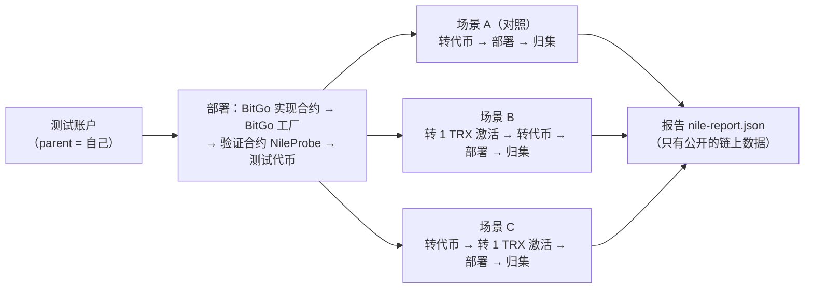

# TRON 合约钱包：Nile 测试网验证

TRON 的充值地址也要用合约钱包（BitGo 转发合约的 CREATE2 地址）。写 TRON 版合约之前，先在 Nile 测试网确认两件事；只要有一件不成立，方案就要改。

| # | 要确认的事 | 为什么重要 | 不成立怎么办 |
|---|---|---|---|
| ① | 充值地址**先被别人转了 TRX**（账户被激活）之后，还能不能在这个地址 CREATE2 部署转发合约 | 合约地址没有私钥。如果激活后部署不了，地址里的 USDT 永远取不出来；而任何人都能往任何地址转一点 TRX 把它激活 | 改成"分配地址时就先部署转发合约"（每个新地址多一笔部署费） |
| ② | 按 **0x41 前缀**算出的地址，和工厂在链上实际部署出的地址一致 | 后端按这个地址收款、批量合约按这个地址归集；算错了钱会进一个没人能动的地址 | 查清 TRON 的规则再改算法 |

顺带记录：TRON 编译器对 `new C{salt: …}()` 用的是 0x41 还是 0xff（我们的合约不用这种写法，只记下结果）。

## 1. 验证怎么做（`verify.mjs`）



- 合约：BitGo `ForwarderV4`、`ForwarderFactoryV4` 用 `contracts/lib/` 里**原样**的源码；验证合约 `contracts/script/tron-nile/NileProbe.sol` 是一个小号批量合约（它是转发地址的 feeAddress，和正式的批量合约一样），里面同时有按 0x41 和按 0xff 算地址的函数。全部用 **TRON 官方编译器 0.8.20**（`compile.mjs`，编译器 sha256 写死）编译，参数和以太坊版一致。
- 每个场景用一个随机盐，逐项核对（都要通过）：
  1. 后端离线按 0x41 算的地址（`tron-create2.mjs`）= 合约里按 0x41 算的地址；
  2. 场景 B、C：部署前这个地址确实已被激活（账户存在、余额 1 TRX、不是合约）；
  3. CREATE2 部署交易成功；工厂事件里的实际地址 = 0x41 地址，≠ 0xff 地址；这个地址现在有合约代码；
  4. 场景 B、C：激活时转进去的 1 TRX 在部署时由 BitGo 的 `init` 转给了 parent，地址余额为 0；
  5. 归集（`flushTokens`）后代币全部到 parent；
  6. 同一个盐再部署一次会被拒绝（不会覆盖已有合约）。
- 测试代币是标准的（`transfer` 返回 true）。TRON USDT"成功也返回 false"的问题由 TRON 版转发合约单独处理和测试，不在这次验证里。
- 安全措施：只准连 Nile 或本机私链（先查 0 号区块，主网直接拒绝）；每笔交易签名前核对交易号 = 交易原文的哈希、交易类型、发起地址；私钥只在内存里用来签名，不打印、不写文件。

## 2. 跑一次要多少测试 TRX

本机 TRON 私链（`tronbox/tre`，java-tron 4.8.2，能量单价 100 sun，和 Nile 当前一样）实测：整套约 **350 TRX**。其中部署 BitGo 实现合约约 190 万能量（约 190 TRX），工厂 22 万、验证合约 48 万、测试代币 36 万；每个场景里工厂部署一个转发合约约 9 万～10 万能量，归集约 1.8 万。Nile 上激活一个新地址另收 1 TRX（私链上是 0）。
脚本要求账户里至少有 **500 TRX** 才开始。

## 3. 怎么跑

### 3.1 不联网、不需要私钥
```bash
npm ci
node scripts/tron-nile/verify.mjs --offline      # 下载并核对编译器、编译、离线算地址
node --test test/tron-nile-create2.test.js       # 离线地址计算的单元测试
```

### 3.2 本机 TRON 私链（CI 的 `tron-local` 就是这样跑的）
```bash
docker run -d --name tre -p 9090:9090 tronbox/tre
# 等日志里出现 "Available Accounts"（约 1 分钟）。私链账户是容器自己生成的、只在这个容器里有效
TOPUP_NILE_PRIVATE_KEY="$(docker logs tre 2>&1 | grep -m1 -E '^\(0\) [0-9a-f]{64}$' | awk '{print $2}')" \
  node scripts/tron-nile/verify.mjs --node http://127.0.0.1:9090
```

### 3.3 Nile 测试网（管理员做）
准备一个**只用于 Nile 的新测试账户**（不要用任何主网账户），在 Nile 水龙头 https://nileex.io/join/getJoinPage 领测试 TRX（填地址、过人机验证；每个地址和 IP 每 24 小时一次）。私钥二选一：

- **做法 A（GitHub 环境密钥，推荐）**：仓库 Settings → Environments → New environment，名字 `nile`；勾选 Required reviewers 并选自己；在这个环境里加密钥 `TOPUP_NILE_PRIVATE_KEY`（可选再加 `TRONGRID_API_KEY`）。之后推送到 `nile-run/` 开头的分支就会触发 `.github/workflows/nile-verify.yml`，管理员在 GitHub 上点批准后才会运行；报告在运行页面的产物 `nile-report` 里。
- **做法 B（自己电脑的终端）**：在自己电脑上 `git clone` 本仓库，`npm ci`，运行 `node scripts/tron-nile/verify.mjs`，按提示粘贴私钥（不显示）。报告写在当前目录的 `nile-report.json`。

TronGrid API Key 可选：设环境变量 `TRONGRID_API_KEY`，请求头 `TRON-PRO-API-KEY`。没有 Key 时请求可能被限流，脚本遇到 429 / 5xx 会退避重试 3 次。

## 4. 看结果
屏幕最后一行是"全部通过"或"有失败项"；`nile-report.json` 里有每一项核对（`checks`）、每笔交易的交易号和能量（`steps`、`energy`）、部署出的合约地址、链参数、`new C{salt}` 的记录。交易可以在 https://nile.tronscan.org 按交易号查。
