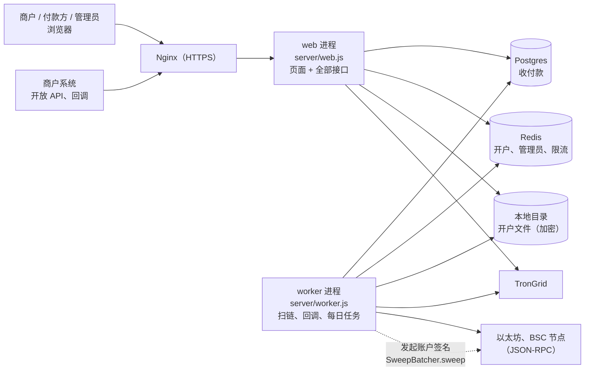

# 项目地图：TopUP
给新成员和编程智能体的第一页：项目是什么、代码怎么分层、环境、不能破坏的约定、常用命令、排查从哪里开始。具体文件、接口、表、环境变量查《[项目索引](项目索引.md)》。
需求和方案在公司内部文档，本仓库只放代码和这两页。

## 一图看懂

web 和 worker 是同一份代码、同一个镜像的两个进程；本地开发和端到端测试只跑 web，用 `/__fake/tick/` 代替 worker。

## 1. 这个项目做什么
稳定币（USDT）收付款：每个客户每条链一个永久收款地址，在客户发起充值时按链生成（订单指定了链，或付款人在付款页选了链；建客户不生成地址）。以太坊、BSC 是合约钱包的 CREATE2 地址；TRON 合约第 2 批上线，第 1 批只给已有的 TRON 地址，到账自动入账、匹配订单、回调商户；商户申请提币，管理员在浏览器里核对并签名后广播；运营后台做归集、对账。另有企业线上开户（KYB）和审核后台。工作名称 TopUP，品牌和域名上线前再定。

## 2. 代码怎么分层
| 目录 | 内容 |
|---|---|
| `server/` | 入口 `web.js`、`worker.js`，共用初始化 `app.js`，配置 `config.js` |
| `server/kyb/` | 开户、管理员登录、加密、开户文件存储 |
| `server/pay/` | 收付款：核心规则、开放 API、商户后台、运营后台、定时任务、TRON |
| `server/wallet/` | 钱包接口层：WalletProvider（contract / cobo / fireblocks）、ChainAdapter（evm）、路由、每条链的地址、归集（半自动） |
| `site/` | 页面（Astro 静态构建），和服务器共用 `server/pay/` 的金额、匹配、签名核对代码 |
| `test/` | 单元测试（`node --test`） |
| `e2e/` | 端到端测试（Playwright） |
| `contracts/` | 智能合约（Foundry）：BitGo 转发合约和 OpenZeppelin 原样源码、批量归集合约 SweepBatcher |

## 3. 环境
| 环境 | 怎么跑 | 数据 |
|---|---|---|
| 本地 | `npm run dev`（`APP_ENV=local`） | Redis 替身、内嵌 Postgres、TronGrid 替身，不需要外部服务 |
| 本地（Docker） | `docker compose up -d postgres redis` 后设 `DATABASE_URL`、`REDIS_URL`；整套 `docker compose --profile app up -d --build` | Postgres 16、Redis 7 |
| 测试环境、生产 | Docker Compose（web、worker、Postgres、Redis）+ Nginx；`APP_ENV=staging` / `production` | 地址和部署方式见公司内部文档 |

生产和测试环境缺少必需的变量时，接口返回 503、健康检查列出哪一项没配置（不返回值）。

## 4. 关键流程在哪里
- 收款：worker → `server/pay/tick.js` 的 `scan`（TRON）/ `server/wallet/scan.js`（以太坊、BSC）→ `server/pay/core.js` 的 `recordDeposit`（按链、地址找客户）→ 匹配（`server/pay/matching.js`）→ 回调（`server/pay/callbacks.js`）。
- 合约钱包归集：worker 到点（东八区 10:00、20:00）凑批 → 邮件 → 运营后台"归集"确认 → 发起账户一笔交易（`server/wallet/sweep.js`、`server/wallet/providers/contract.js`）→ worker 按回执逐个地址确认。
- 提币和归集签名：`server/pay/wallet-api.js` 生成交易原文 → 浏览器 `site/src/scripts/admin-pay-real.ts` 解码核对（`server/pay/verify.js`）并签名 → 服务器验签后广播。
- 开户：`server/kyb/onboarding.js`（企业填写）→ `server/kyb/admin.js`（审核）→ 审核通过的企业出现在运营后台"待开通商户"（`server/pay/kyb-link.js`）。

## 5. 不能破坏的约定
1. 服务器不保存能转走钱的私钥和助记词：TRON 签名在浏览器里完成，服务器只收签名；签名页面解码交易原文必须严格（`server/pay/txcodec.js` 的 `decodeRaw`：每层白名单、同号字段只许一次），不能改回"取第一个"；签名页面只认 `config/wallets.json` 里的地址，改地址要提交 PR。以太坊、BSC 的归集发起账户私钥（`SWEEP_OPERATOR_KEY`）在服务器上，但它只能调用批量合约，钱只能进合约里写死的冷钱包；合约地址在 `config/wallets.json` 的 `evm`，改也要提交 PR。
2. 账本只追加，余额只随账本改动；金额一律用 0.000001 USDT 为单位的整数，接口里一律是字符串。
3. 敏感字段加密保存（`APP_SECRET` 派生的密钥）；`APP_SECRET` 不能更换。开户文件加密写盘。
4. 页面只用外部脚本和样式（严格 CSP）；`site/src/scripts/ui.ts` 的 `h()` 只用 `textContent`。
5. 同一时间只有一个 worker 在跑（数据库租约）；定时任务没有对外的接口。
6. 密钥只放在服务器的 `.env` 和 GitHub 的仓库设置里，不进仓库；`.env.example` 只有变量名。
7. 开放 API 的签名格式和回调格式改动要同时改 `site/src/docs/api-reference.mjs`，`test/docs-reference.test.js` 会核对。
8. 钱包层的规则：地址创建时记下提供方，切换只影响新地址；停用的旧地址一直扫链、照常入账、由原提供方归集；归集不写账本、不改商户余额；归集确认要管理员点（原因页面预填"例行归集"），改门槛和切换提供方要动态码。
9. 归集发送：签名前出错（节点连不上）批次退回待确认、钱没动；签名后广播时连接出错不算失败，记下本地算出的交易号按交易号查；只有节点明确拒绝才算发送失败。
10. ETH、BSC 合约参数（`config/wallets.json` 的 `evm`）启动时和看系统状态时用 `eth_call` 和链上批量合约核对，不一致的链停用并告警（不影响健康检查整体 ok）。

## 6. 常用命令
```bash
npm ci && npm test                                  # 单元测试
node scripts/check-project-index.mjs                # 项目地图和索引检查
cd site && npm ci && npm run build                  # 构建页面
cd e2e && npm ci && npx playwright test             # 端到端测试（先构建页面）
npm run dev                                         # 本地运行 web（http://127.0.0.1:8080）
POSTGRES_PASSWORD=... docker compose up -d postgres redis   # 本地 Postgres 和 Redis（口令自己定，没有默认值）
```

## 7. 排查从哪里开始
- 健康检查 `/api/health/`：哪一项没配置、worker 最近一次运行距今多少秒。
- 收不到款：worker 日志 → `pay_meta` 的 `scan_cursor`（TRON）、`evm_cursor_<链>`、`tick_last` → 运营后台"系统状态"每条链的卡片。
- 接口 503：看健康检查和 web 日志里的 `[web] init failed`（只有变量名或错误类别）。
- 端到端测试失败：`e2e/.tmp/web-<端口>.log`、`e2e/test-results/`。

## 8. 已知限制
- 第 1 批：以太坊、BSC 合约钱包；TRON 合约、批量打款在后续批次。新建客户不再派生 TRON 地址（`customers.address`、`hd_index` 只有老客户有），也不需要 TRON 主助记词。
- 手续费占比规则要有原生币价格才判断，第 1 批没有价格来源，暂不按占比跳过（后台写明"现在没有币价来源，本批暂不按占比检查"）。
- 运营概览的资金按三条链合计；ETH、BSC 第 1 批只有冷钱包（没有热钱包）。
- Nginx 配置、备份和回滚脚本由部署负责，不在本仓库。
